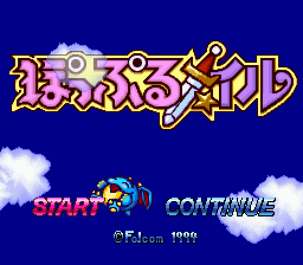
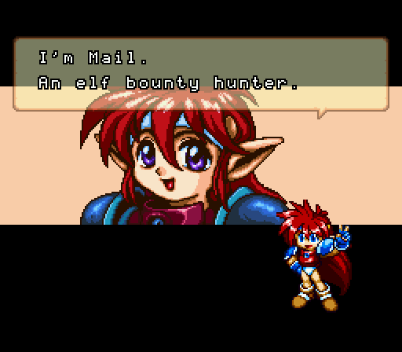
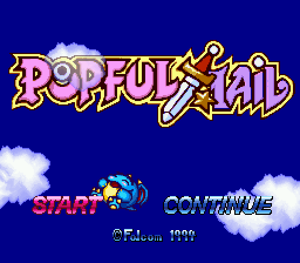

# Popful Mail (SFC) — English Translation

An English fan translation of **Popful Mail** for the Super Famicom (Falcom, Japanese release), distributed as a patch for the original ROM.

<p>


</p>

**v1.0 — complete.** Every message, menu, status screen, map label, shop, the story scroll and the staff credits are in English, set in an original font. The game has been played through to "THE END?" on the patched ROM.

This is a new translation of the Super Famicom version. It does not use the script from the English Sega CD release.

## Download

Get the patches from the [Releases](../../releases) page. There are two editions:

| Edition | Title screen | Patch |
|---|---|---|
| Standard | original Japanese logo | `popful_mail_en_v1.0.bps` / `.ips` |
| English logo | English "POPFUL MAIL" logo | `popful_mail_en_v1.0_englishlogo.bps` / `.ips` |

Everything apart from the title logo is identical. Apply **one** of them to the original ROM:

- **ROM:** `Popful Mail (Japan).sfc`, 1 MB, no copier header, CRC32 `88E5BCDF`
- **Result:** 2 MB LoROM. CRC32 `6616CC3A` (standard) or `CAB1A85F` (English logo)
- The `.bps` file checks the source ROM before patching and is the one to use. Any BPS patcher works, such as [Floating IPS](https://github.com/Alcaro/Flips) or [Rom Patcher JS](https://www.marcrobledo.com/RomPatcher.js/).

ROMs are not provided here.



## Building from source

Requirements:

- Python 3 (tested with 3.13), plus `numpy` for the English-logo edition
- [Asar](https://github.com/RPGHacker/asar) 1.91 on your `PATH`, or set `ASAR` to the executable
- your own copy of the ROM, placed at `rom/Popful Mail (Japan).sfc` (or set `PM_ROM`)

```sh
python3 patch/make.py build/popful_mail_en.sfc                    # standard edition
PM_LOGO=en python3 patch/make.py build/popful_mail_en_logo.sfc    # English-logo edition

# patches (.bps and .ips) from original -> built ROM
python3 patch/mkpatch.py "rom/Popful Mail (Japan).sfc" build/popful_mail_en.sfc build/popful_mail_en_v1.0
```

The first build also decodes a message index from your ROM into `out/`. The standard build takes about 2 minutes; the English-logo build about 15, because the logo data only fits with the slowest compression setting. Both reproduce the released v1.0 ROMs byte for byte.

## Repository layout

| Path | Contents |
|---|---|
| `script/popful_mail_translation.tsv` | the English script, one row per message (2,425); `script/NOTATION.txt` explains the control codes |
| `patch/overrides.tsv`, `condensed.tsv`, `extra_msgs.tsv` | later corrections and re-fits; these take priority over the script |
| `patch/names.tsv`, `substrings.tsv` | speaker labels and text inside shared substrings |
| `patch/engine.asm` | 65816 code: English text engine, centring, the story scroll and other display fixes |
| `patch/*.py` | the build: font, text insertion and pointer rewriting, menus, map labels, credits, title logo |
| `patch/logo_en.npy`, `logo/` | English title logo and the script that converts it into the title screen's palette |
| `data/streams.json` | locations of the game's compressed data streams |
| `tools/` | LZ compressor/decompressor, table, disassembler, script and pointer checks |
| `playtest/` | automated play-testing toolkit built for this project (see `playtest/README.md`) |
| `docs/` | release notes for every version and the development log |

To look at the Japanese next to the English, run `python3 tools/side_by_side.py`. It decodes the Japanese from your ROM into `out/side_by_side.tsv`; the Japanese script itself is not stored in this repository.

## Notes

- In-game saves carry over between patch versions. Emulator save states made with an older version of the patch can show old text or crash, because they hold the old code in memory.
- Some staff-name readings in the credits could not be confirmed from a published source (see `docs/release_notes/README_v0.6.txt`). Corrections are welcome — please open an issue.

## License

- Source code (build scripts, tools, assembly, playtest toolkit): [MIT](LICENSE). The snes9x debug patch in `playtest/` follows the snes9x license.
- Translation text, the project's English letter designs, the English logo and the docs: [CC BY-NC 4.0](LICENSE-TRANSLATION.md). This covers only this project's own contributions; nothing here grants rights in Falcom's game. Please don't sell the patch or patched ROMs and carts.

## Credits

- Translation patch: Netrunner12
- English title logo: created with ChatGPT

Popful Mail © Nihon Falcom. This is an unofficial fan project, not affiliated with or endorsed by Falcom or any other rights holder.
